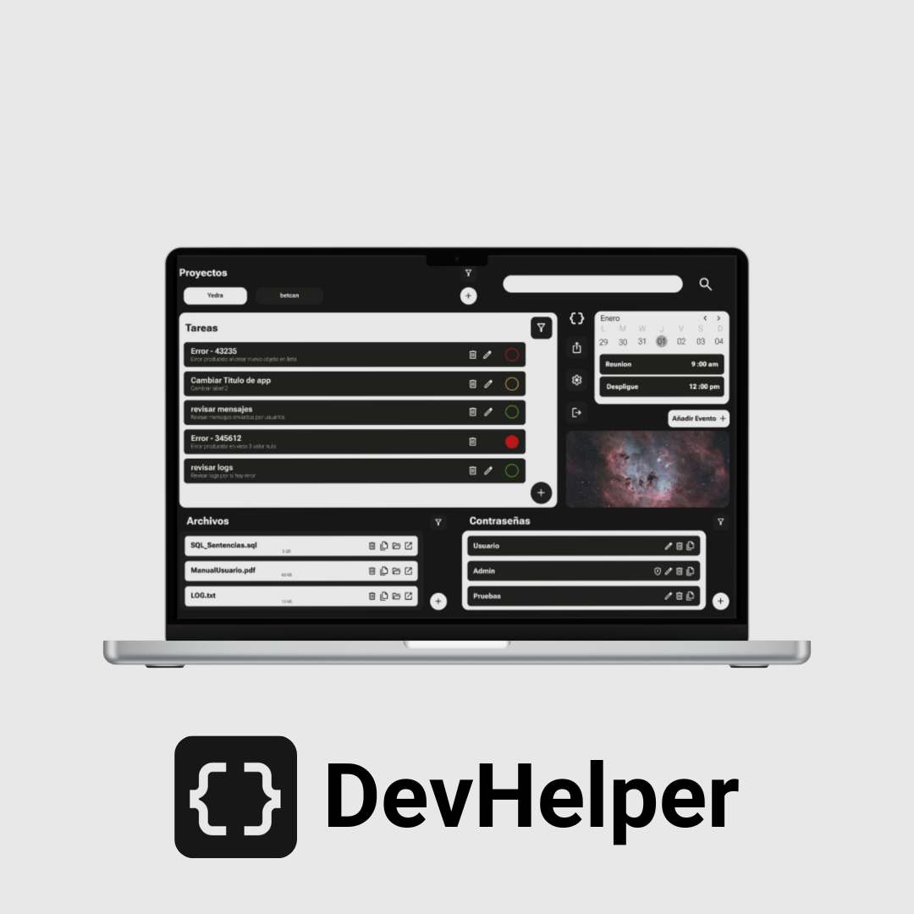
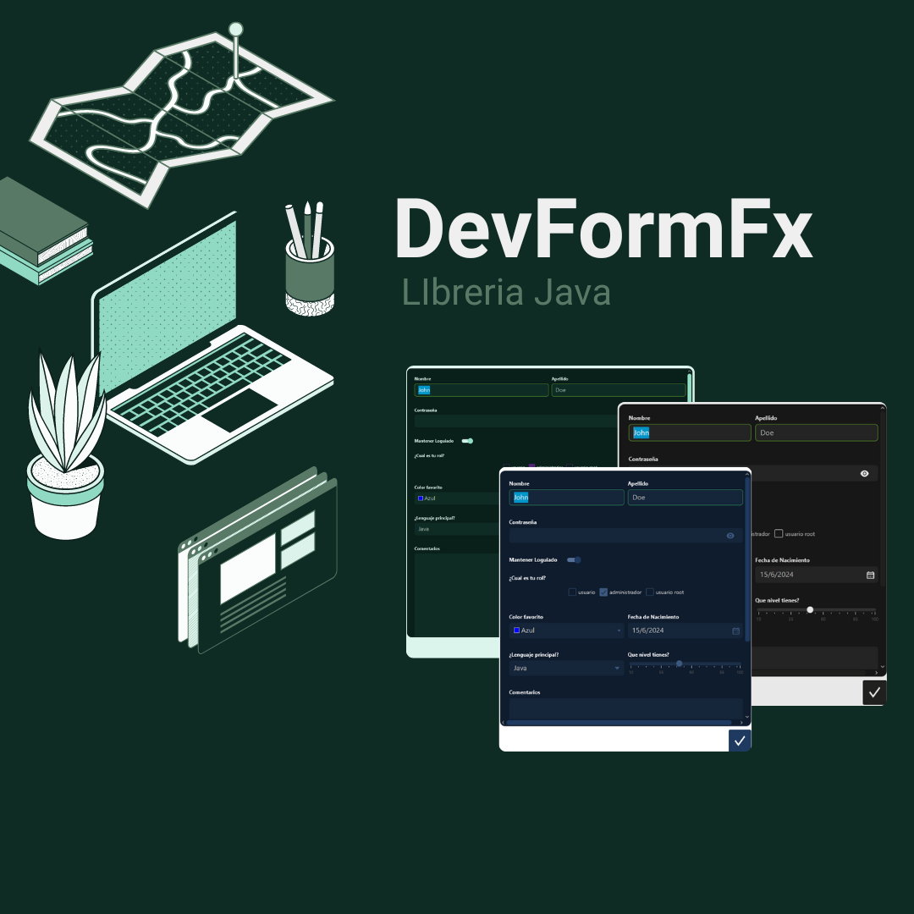
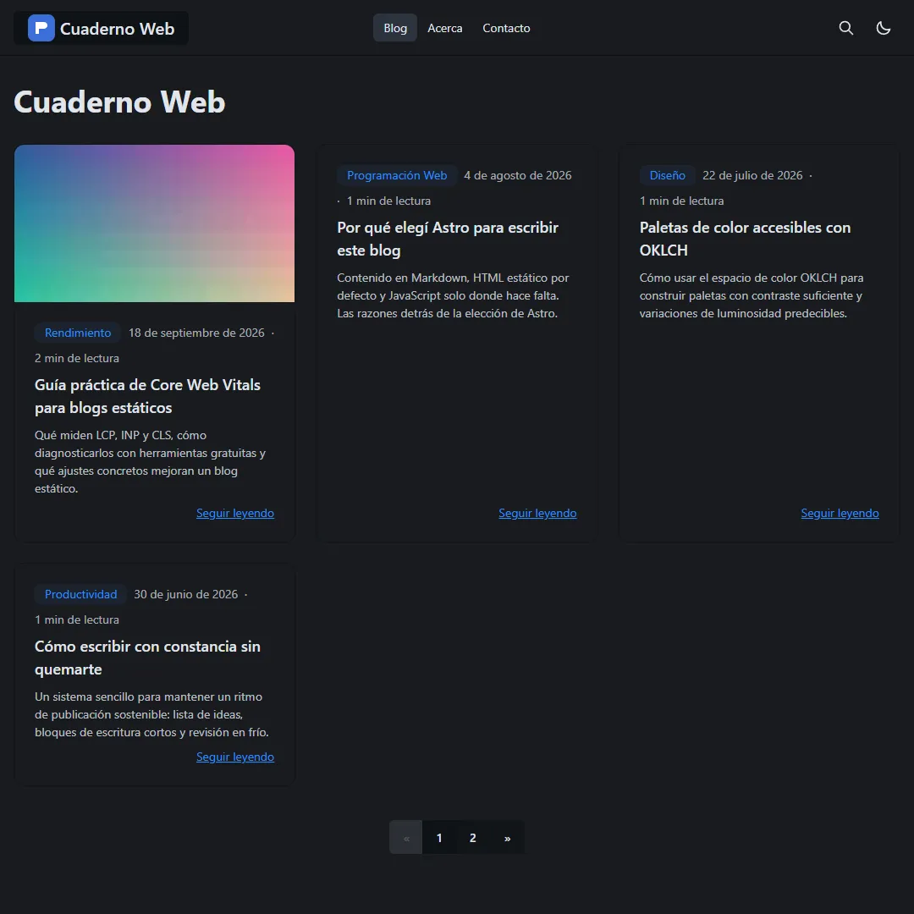

<a href="https://portafolio-71784.web.app/es">
  
</a>

<p align="center">
  <a href="https://portafolio-71784.web.app/es"></a>
  <a href="https://portafolio-71784.web.app/documents/cv_didier_piracoca.pdf"></a>
  <a href="https://www.linkedin.com/in/didier-estiben-piracoca-campos-460828216/"></a>
  <a href="mailto:piracocadidier@gmail.com"></a>
</p>

```console
> inicializando portafolio ...
> cargando proyectos ...
> sistema listo ✔
```

## `$ cat about-me.txt`


Soy Didier — **desarrollador**, enfocado en construir software ***diseñado para evolucionar***.
Disfruto resolver problemas complejos, trabajar desde cero y convertir ideas en aplicaciones bien estructuradas.

Con un fuerte enfoque en **desarrollo frontend** y una visión amplia de **backend y arquitectura de software**,
me importa construir cosas que no solo funcionen, sino que sean **mantenibles**, **escalables** y listas para lo que venga.

`frontend` • `angular` • `full-stack`

<br clear="right"/>

### `// experience`

| Año | | |
|:---:|---|---|
| **2023 → hoy** | 💼 **Desarrollador Angular** · [AXPE Consulting](https://www.axpe.com/) | Desarrollo de aplicaciones web con **Spring MVC** e **Ionic** · Integración con **Oracle SQL** (consultas optimizadas y modelado de datos) · Mantenimiento, corrección de errores y soporte en producción · Entrega de funcionalidades **full-stack** |
| **2021 – 2023** | 🎓 **Grado Superior en Desarrollo de Aplicaciones Multiplataforma** · [Gobierno de Cantabria](https://www.educantabria.es/) | Fundamentos de ingeniería de software · Diseño de bases de datos y SQL · Desarrollo de interfaces de usuario |
| **20??** | 🚀 *¡Tú puedes ser el próximo! :D* | |

### `// skills --graph`

<p>
  <b>Frontend</b><br/>
  
</p>
<p>
  <b>Backend &amp; móvil</b><br/>
  
</p>
<p>
  <b>Herramientas</b><br/>
  
</p>

> También trabajo con **Ionic**, **Oracle SQL**, **JWT**, **Keycloak** y asistentes de IA como **Claude** y **OpenCode**.

## `$ ls projects/`

<table>
  <tr>
    <td width="50%" valign="top">
      <a href="https://devhelper.didierpiracoca.com/"></a>
      <h3>DevHelper</h3>
      <code>ESTADO</code> completado<br/>
      <code>TECNOLOGÍAS</code> Angular, Tailwind, Firebase
      <p>Tu memoria técnica cifrada en un solo lugar. Centraliza proyectos, errores, soluciones, passwords y ficheros con cifrado client-side desbloqueado por PIN o Passkey.</p>
      <a href="https://devhelper.didierpiracoca.com/">🌐 Web</a> ·
      <a href="https://github.com/DidierPiracocaCampos/DevHelper">💻 Código</a> ·
      <a href="https://www.instagram.com/devhelper_startup/">📸 Instagram</a> ·
      <a href="https://www.figma.com/design/7ts8wiOfzLFndoeHpIG90W/HelperDev?node-id=0-1&t=bWqn2pppP5ElVw4y-1">🎨 Figma</a>
    </td>
    <td width="50%" valign="top">
      <a href="https://github.com/DidierPiracocaCampos/DevFormFx"></a>
      <h3>DevFormFX</h3>
      <code>ESTADO</code> completado<br/>
      <code>TECNOLOGÍAS</code> Java, JavaFX, Maven
      <p>Librería Java para formularios dinámicos en JavaFX. Define el layout con filas y columnas con <code>DevFormBuilder</code> e integra inputs y acciones a medida.</p>
      <a href="https://github.com/DidierPiracocaCampos/DevFormFx">💻 Código</a>
    </td>
  </tr>
  <tr>
    <td width="50%" valign="top">
      <a href="https://github.com/DidierPiracocaCampos/SPOT"></a>
      <h3>SPOT</h3>
      <code>ESTADO</code> completado<br/>
      <code>TECNOLOGÍAS</code> Android, Java, Gradle, Firebase
      <p>App móvil para skaters: descubre skateparks y spots, conecta con la comunidad, comparte trucos, crea tu perfil y explora la tienda integrada.</p>
      <a href="https://github.com/DidierPiracocaCampos/SPOT">💻 Código</a> ·
      <a href="https://www.instagram.com/spot.skate_app/">📸 Instagram</a>
    </td>
    <td width="50%" valign="top">
      <a href="https://github.com/DidierPiracocaCampos/astroblog"></a>
      <h3>astroblog</h3>
      <code>ESTADO</code> completado<br/>
      <code>TECNOLOGÍAS</code> Astro, TypeScript, Tailwind, daisyUI
      <p>Integración de Astro que convierte un proyecto vacío en un blog estático completo: SEO, RSS, búsqueda con Pagefind, páginas legales y consentimiento listo para AdSense, desplegable en Cloudflare Pages.</p>
      <a href="https://github.com/DidierPiracocaCampos/astroblog">💻 Código</a> ·
      <a href="https://www.npmjs.com/package/@didierp/astroblog">📦 npm</a>
    </td>
  </tr>
</table>

## `$ git log --stats`

<p align="center">
  
</p>

## `$ npm run contact`

```console
> inicializando modulo de contacto ...
```

<p>
  <a href="mailto:piracocadidier@gmail.com"></a>
  <a href="https://www.linkedin.com/in/didier-estiben-piracoca-campos-460828216/"></a>
  <a href="https://www.instagram.com/diper_2.0/"></a>
  <a href="https://portafolio-71784.web.app/es"></a>
</p>

<sub>`> mensaje enviado [OK]` — Hecho con ☕ y Angular · <a href="https://portafolio-71784.web.app/en">English version of my portfolio</a></sub>
